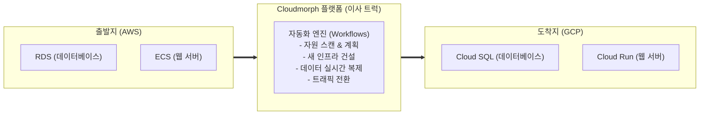

# [초보자 가이드] AWS & GCP 첫걸음부터 무중단 클라우드 마이그레이션까지
> **클라우드를 처음 접하는 분들을 위해 계정 가입, 결제 설정, 키 발급, 플랫폼 연동, 실습 후 요금 방지까지 하나하나 안내하는 완벽 입문서입니다.**

---

## 🧭 시작하기 전에: 클라우드와 이전(Migration)의 기본 개념

처음 클라우드를 접하면 낯선 용어들이 많이 등장합니다. 세 가지만 기억하시면 됩니다:

1. **소스(Source) = AWS**: 현재 우리 서비스가 실행되고 있는 기존 집입니다. (데이터베이스와 웹 서버가 돌아갑니다.)
2. **목적지(Target) = GCP (Google Cloud)**: 우리가 새로 이사 가려는 새 집입니다.
3. **Cloudmorph (우리 플랫폼)**: 집주인이 짐(데이터베이스와 컨테이너)을 싸서 새 집으로 옮기는 동안, 손님(사용자)이 끊기지 않도록 실시간으로 복제하고 스위칭해 주는 **'무중단 자동 이사 트럭'**입니다.



---

## 📑 전체 진행 순서

| 단계 | 소요 시간 | 주요 작업 내용 | 준비물 |
| :--- | :---: | :--- | :--- |
| **1단계: AWS 가입 및 키 발급** | 약 10분 | AWS 계정 생성, IAM 사용자 만들기, Access Key 발급 | 이메일, 해외결제 카드 |
| **2단계: GCP 가입 및 키 발급** | 약 10분 | Google Cloud 가입, \$300 무료 크레딧 수령, 서비스 계정 키 발급 | Google 계정, 해외결제 카드 |
| **3단계: 플랫폼 시크릿 등록** | 약 2분 | 발급받은 키를 Cloudmorph에 안전하게 암호화 저장 | 터미널 1줄 실행 |
| **4단계: 브라우저에서 마이그레이션 실행** | 약 5분 | UI(`localhost:3000`)에서 값 입력 후 클릭 몇 번으로 이전 완료 | 웹 브라우저 |
| **5단계: 실습 후 요금 0원 만들기** | 약 3분 | 불필요한 과금을 막기 위한 자원 삭제 (Clean-up) | 터미널 / 웹 콘솔 |

---

## 1단계: AWS 신규 가입부터 Access Key 발급까지

### 1.1 AWS 계정 만들기 (무료 12개월 프리티어)
1. 인터넷 브라우저를 열고 [AWS 공식 회원가입 페이지](https://portal.aws.amazon.com/billing/signup)로 접속합니다.
2. **이메일 주소**와 **AWS 계정 이름**을 입력하고 `인증 코드 전송`을 눌러 이메일 인증을 마칩니다.
3. **암호**를 설정합니다. (영문 대소문자, 숫자, 특수문자 조합)
4. 연락처 정보에서 **[개인 - 개인 프로젝트용]**을 선택하고 이름, 전화번호, 주소를 입력합니다.
5. **결제 정보 입력 (신용/체크카드)**:
   - 해외 결제(VISA, MasterCard, AMEX 등)가 가능한 카드를 입력합니다.
   - > [!NOTE]
     > 카드 유효성 확인을 위해 약 `\$1`이 가결제되지만, 며칠 내로 전액 자동 취소되거나 즉시 환불됩니다.
6. 휴대전화 SMS 또는 음성 전화로 본인 확인을 완료합니다.
7. 지원 플랜 선택 화면에서 반드시 **[기본 지원 - 무료 (Basic Support - Free)]**를 선택합니다.
8. 가입이 완료되면 [AWS Management Console](https://console.aws.amazon.com/)에 로그인합니다. (이때 로그인한 계정을 **루트 사용자**라고 부릅니다.)

---

### 1.2 왜 루트 계정 대신 IAM 사용자를 써야 하나요?
> [!WARNING]
> **루트 계정**은 신용카드 결제 변경, 계정 삭제 등 모든 권한을 가진 마스터 열쇠입니다. 이 키가 외부에 노출되면 수천만 원의 요금 폭탄을 맞을 수 있습니다.  
> 따라서 실제 프로그램이나 작업에는 특정 권한만 부여된 **IAM 사용자(일반 사원 계정)**를 만들어 사용하는 것이 클라우드의 절대 원칙입니다.

---

### 1.3 마이그레이션 전용 IAM 사용자 만들기 (화면 클릭 가이드)
1. AWS 콘솔 상단 검색창에 `IAM`을 입력하고 가장 위에 나오는 **IAM** 서비스를 클릭합니다.
2. 좌측 메뉴에서 **[사용자(Users)]**를 클릭하고 우측 상단의 주황색 **[사용자 생성(Create user)]** 버튼을 클릭합니다.
3. **사용자 세부 정보 지정**:
   - 사용자 이름: `cloudmorph-migrator` 입력
   - *AWS Management Console에 대한 사용자 액세스 권한 제공* 체크박스는 **체크 해제**한 채로 둡니다 (프로그램 연동 전용 키만 쓸 것이기 때문입니다).
   - 우측 하단 **[다음(Next)]** 클릭.
4. **권한 설정**:
   - 3가지 옵션 중 **[직접 정책 연결(Attach policies directly)]**을 선택합니다.
   - 아래 목록에서 우측의 **[정책 생성(Create policy)]** 버튼을 클릭합니다 (새 창이 뜹니다).
5. **정책 생성 (새 창)**:
   - 정책 편집기에서 **JSON** 탭을 클릭합니다.
   - 기존 내용을 모두 지우고, 아래의 권한 텍스트를 그대로 복사해서 붙여넣습니다:

```json
{
  "Version": "2012-10-17",
  "Statement": [
    {
      "Sid": "CloudmorphAssessmentReadOnly",
      "Effect": "Allow",
      "Action": [
        "ecs:DescribeServices",
        "ecs:DescribeTaskDefinition",
        "ecs:DescribeClusters",
        "ecs:ListTasks",
        "ecs:DescribeTasks",
        "rds:DescribeDBInstances",
        "rds:DescribeDBSubnetGroups",
        "rds:DescribeDBParameters",
        "ec2:DescribeVpcs",
        "ec2:DescribeSubnets",
        "ec2:DescribeSecurityGroups",
        "ec2:DescribeRouteTables",
        "secretsmanager:GetSecretValue",
        "secretsmanager:DescribeSecret"
      ],
      "Resource": "*"
    },
    {
      "Sid": "AllowSTSAssumeRole",
      "Effect": "Allow",
      "Action": "sts:AssumeRole",
      "Resource": "arn:aws:iam::*:role/cloudmorph-*"
    }
  ]
}
```
> [!NOTE]
> IAM Role 위임을 사용하지 않는 환경이라면 위의 `AllowSTSAssumeRole` 블록은 생략하셔도 무방합니다.

6. 우측 하단 **[다음]** ➔ 정책 이름에 `CloudmorphAssessmentPolicy` 입력 ➔ **[정책 생성]** 클릭.
7. 이전 브라우저 탭(사용자 생성 창)으로 돌아와서 검색창 옆 **새로고침 아이콘(↻)**을 누릅니다.
8. 검색창에 `CloudmorphAssessmentPolicy`를 검색하고 좌측 체크박스를 선택한 뒤 **[다음]** ➔ **[사용자 생성]**을 누릅니다.

---

### 1.4 Access Key(접속 키) 발급 및 안전한 보관
1. 방금 생성된 `cloudmorph-migrator` 사용자 이름을 클릭합니다.
2. 상단 탭 중 **[보안 자격 증명(Security credentials)]**을 클릭합니다.
3. 스크롤을 조금 내려 **액세스 키(Access keys)** 영역 우측의 **[액세스 키 만들기(Create access key)]** 버튼을 누릅니다.
4. 사용 사례에서 **"Command Line Interface (CLI)"**를 선택하고, 하단의 "위의 권장 사항을 이해했으며..." 체크박스를 체크한 뒤 **[다음]**을 누릅니다.
5. 설명 태그는 비워두고 **[액세스 키 만들기]**를 클릭합니다.
6. 화면에 두 가지 중요한 값이 나타납니다:
   - **액세스 키 (Access Key ID)**: `AKIA...` 로 시작하는 20자리 영문/숫자
   - **비밀 액세스 키 (Secret Access Key)**: `wJalr...` 로 되어 있는 40자리 비밀 문자열
7. 반드시 **[.csv 파일 다운로드]**를 눌러 안전한 곳에 저장하고, 두 값을 메모장에 임시로 적어둡니다.
   > [!CAUTION]
   > 비밀 액세스 키는 이 창을 닫으면 다시는 화면에서 볼 수 없습니다!

---

### 1.5 Mac 터미널에서 AWS 연동하기
Mac 터미널(터미널 앱 또는 iTerm)을 열고 아래 명령어를 순서대로 실행합니다:

```bash
# 1. AWS CLI 프로그램 설치 (이미 설치되어 있다면 건너뛰셔도 됩니다)
brew install awscli

# 2. 방금 발급받은 키 등록하기
aws configure
```

입력 프롬프트가 나타나면 하나씩 입력하고 엔터를 칩니다:
```text
AWS Access Key ID [None]: <메모해둔 Access Key ID 붙여넣기>
AWS Secret Access Key [None]: <메모해둔 Secret Access Key 붙여넣기>
Default region name [None]: ap-northeast-2
Default output format [None]: json
```

잘 연결되었는지 확인해 봅니다:
```bash
aws sts get-caller-identity
```
> 본인의 `cloudmorph-migrator` 이름과 계정 번호가 출력되면 AWS 준비 완료입니다! 🎉

---

## 2단계: GCP 신규 가입부터 서비스 계정 키 발급까지

### 2.1 Google Cloud 가입 및 \$300 무료 크레딧 받기
1. 크롬 브라우저에서 [Google Cloud 공식 웹사이트](https://cloud.google.com/free)에 접속합니다.
2. 우측 상단의 **[무료로 시작하기 (Get started for free)]** 파란색 버튼을 누릅니다.
3. 본인의 Google 계정으로 로그인합니다.
4. 1단계: 국가(대한민국) 선택 및 동의 체크.
5. 2단계: 본인 인증 및 결제 프로필 등록.
   - 해외 결제 가능한 신용/체크카드 정보를 입력합니다.
   > [!TIP]
   > **안심하세요!** 신규 가입 시 제공되는 **\$300 무료 크레딧**(약 40만 원 상당)이 먼저 소진되며, 무료 체험 기간이 끝나더라도 유료 계정으로 직접 전환(업그레이드)을 누르지 않는 한 **자동으로 요금이 청구되지 않습니다.**

---

### 2.2 프로젝트(Project) 생성하기
GCP에서는 모든 서버, DB, 설정이 **'프로젝트'**라는 하나의 울타리 안에서 격리되어 관리됩니다.

1. [Google Cloud Console 홈](https://console.cloud.google.com/)에 접속합니다.
2. 상단 네비게이션 바 왼쪽의 **[프로젝트 선택 (Select a project)]** 드롭다운을 클릭합니다.
3. 팝업창 우측 상단의 **[새 프로젝트 (New Project)]**를 누릅니다.
4. 프로젝트 이름에 `cloudmorph-demo`를 입력합니다 (프로젝트 ID는 자동으로 고유한 문자열이 붙습니다, 예: `cloudmorph-demo-440212`).
5. **[만들기]** 버튼을 누릅니다.
6. 상단 알림 아이콘에서 프로젝트 생성이 완료되면 방금 만든 프로젝트를 선택해 이동합니다.

---

### 2.3 서비스 계정(Service Account) 만들기
서비스 계정이란 **"사람이 아닌 프로그램(Cloudmorph)이 GCP에 로그인할 때 쓰는 전용 로봇 계정"**입니다.

1. 콘솔 좌측 상단 햄버거 메뉴(≡) ➔ **[IAM 및 관리자]** ➔ **[서비스 계정(Service Accounts)]** 클릭.
2. 상단의 **[+ 서비스 계정 만들기]** 클릭.
3. **1단계: 서비스 계정 세부정보**:
   - 서비스 계정 이름: `terraform-runner`
   - 서비스 계정 ID: 자동으로 채워집니다.
   - **[만들고 계속하기]** 클릭.
4. **2단계: 이 서비스 계정에 프로젝트 액세스 권한 부여 (역할)**:
   - 드롭다운에서 **[기본]** ➔ **[편집자 (Editor)]**를 선택합니다.
   > [!NOTE]
   > 빠른 실습 환경을 위해 '편집자(Editor)' 역할을 안내하고 있습니다. 프로덕션 환경에서는 Cloud Run 관리자, Cloud SQL 관리자, Secret Manager 접근자, 서비스 네트워킹 관리자 등 최소 권한 역할을 분리 부여하는 것을 권장합니다.
   - **[계속]** ➔ **[완료]** 클릭.

---

### 2.4 로봇 전용 열쇠(JSON 키 파일) 발급받기
1. 방금 생성된 `terraform-runner@...` 계정의 이메일 주소를 클릭합니다.
2. 상단 탭 중 **[키(Keys)]** 탭으로 들어갑니다.
3. **[키 추가]** ➔ **[새 키 만들기]** 클릭.
4. 키 유형: **JSON (권장)** 선택 ➔ **[만들기]** 클릭.
5. 컴퓨터의 `다운로드` 폴더에 `.json` 파일이 다운로드됩니다!
6. 이 파일을 안전한 설정 폴더로 복사합니다 (터미널에서 실행):

```bash
mkdir -p ~/.config/gcloud
# 다운로드 폴더에 있는 json 키를 cloudmorph-sa-key.json 으로 복사
cp ~/Downloads/*terraform-runner*.json ~/.config/gcloud/cloudmorph-sa-key.json
```

---

### 2.5 필수 API 켜기 (CLI 1줄 실행)
GCP는 처음 만들었을 때 보안과 자원 절약을 위해 모든 기능(Cloud SQL, Cloud Run 등)이 비활성화되어 있습니다. 터미널에서 다음 명령어로 켜줍니다:

```bash
# 본인의 프로젝트 ID로 설정 (콘솔 상단에서 확인한 ID 입력)
export MY_GCP_PROJECT="cloudmorph-demo-XXXXXX"

# gcloud 기본 프로젝트 지정
gcloud config set project $MY_GCP_PROJECT

# 마이그레이션에 필요한 핵심 기능들 켜기
gcloud services enable \
  compute.googleapis.com \
  sqladmin.googleapis.com \
  run.googleapis.com \
  artifactregistry.googleapis.com \
  secretmanager.googleapis.com \
  servicenetworking.googleapis.com
```

---

## 3단계: Cloudmorph 플랫폼에 시크릿 등록하기

Cloudmorph 플랫폼은 보안을 위해 원본 AWS 비밀번호나 GCP 키를 평문으로 저장하지 않고, **로컬 SQLite에 군사 등급 암호화(AES-128)**로 안전하게 감추어 둡니다.

여러분을 위해 **원클릭 등록 스크립트**가 이미 준비되어 있습니다.

터미널에서 아래 명령어를 한 번만 실행하시면 끝납니다 (저장소 루트 기준):

```bash
cd apps/backend
uv run python scripts/register_secrets.py
```

실행하면 원본·대상 DB 비밀번호와 AWS 키를 묻습니다. 입력은 화면에 보이지 않습니다. 저장소에는 고정 비밀번호가 없으니 DB 를 만들 때 정한 값을 그대로 넣으세요. `SOURCE_DB_PASSWORD`, `TARGET_DB_PASSWORD`, `AWS_ACCESS_KEY_ID`, `AWS_SECRET_ACCESS_KEY` 환경변수가 있으면 묻지 않습니다.

> **출력 결과:**
> ```text
> [*] Registering secrets with prefix: secret://default/...
>   [+] Registered: secret://default/source-cloud
>   [+] Registered: secret://default/source-db-admin
>   [+] Registered: secret://default/target-cloud
>   [+] Registered: secret://default/target-admin
> 
> ✅ All secrets successfully encrypted and stored in local SQLite!
> ```

이제 `secret://default/source-cloud`와 `secret://default/source-db-admin`이라는 안전한 **'이름표'**가 생성되었습니다.

---

## 4단계: UI에서 마이그레이션 실행하기 (클릭 가이드)

### 4.1 브라우저 열기
웹 브라우저(크롬, 사파리 등)를 열고 주소창에 아래 주소를 입력합니다:
👉 **`http://localhost:3000`**

---

### 4.2 입력 폼 채우기
아래 표대로 **3개 항목**만 입력하고, 목적지 클라우드는 기본값을 그대로 두면 됩니다:

| 화면 레이블 | 입력할 내용 | 설명 |
| :--- | :--- | :--- |
| **서비스 이름** | `target-app` | 이전할 ECS 서비스 이름 |
| **원본 AWS 자격증명 참조** | `secret://default/source-cloud` | 방금 3단계에서 등록한 AWS 인증 이름표 |
| **원본 DB 관리자 참조** | `secret://default/source-db-admin` | 방금 3단계에서 등록한 DB 비밀번호 이름표 |

*(원본 리전은 `ap-northeast-2`, 목적지는 GCP `asia-northeast3` 가 기본입니다. RDS 는 계정에 하나뿐이면 자동으로 고릅니다. 다르게 쓰려면 "고급 클라우드 설정"을 여세요.)*

---

### 4.3 이전 요청 시작 및 승인하기

1. 하단의 파란색 **[이전 요청 생성]** 버튼을 클릭합니다.
2. **실시간 대시보드 화면(`/runs/[id]`)**으로 즉시 이동합니다.
3. **Discovery & Planning**:
   - 플랫폼이 자동으로 소스 환경을 분석하고 대상 인프라 스펙(Cloud Run 1 vCPU, 512MiB + Cloud SQL PostgreSQL 16)을 자동으로 설계합니다.
   - 100% 완료되면 **`승인 대기 (waiting_approval)`** 상태로 안전하게 멈춥니다.
4. **계획 승인 ① (`Plan Approval`)**:
   - 화면에 표시된 요약과 리스크 점검표를 확인합니다.
   - 의견(Comment)란에 `승인합니다`라고 적고 주황색 **[계획 승인 ①]** 버튼을 누릅니다!
5. **무중단 이전 진행**:
   - Terraform이 새 GCP 인프라를 구축하고, Debezium CDC가 실시간으로 데이터베이스를 동기화합니다.
   - 모든 검증이 끝나면 **전환 승인 ②**를 거쳐 트래픽이 0.1초 만에 안전하게 스위칭됩니다.

---

## 5단계: 실습 후 요금 0원 만들기 (비용 방지 Clean-up)

실습이 끝난 후 불필요하게 클라우드 요금이 청구되지 않도록 리소스를 깔끔하게 지우는 방법입니다.

### 5.1 GCP 리소스 1초 만에 완벽 삭제 (강력 추천)
GCP는 프로젝트 자체를 삭제하면 그 안에 생성된 모든 서버, 데이터베이스, 네트워크가 **영구 삭제**되어 10원의 추가 요금도 발생하지 않습니다.

1. [GCP 콘솔 리소스 관리](https://console.cloud.google.com/iam-admin/settings)로 이동합니다.
2. 상단의 **[삭제(종료)]** 버튼을 누르고 프로젝트 ID를 입력하면 즉시 모든 자원이 소멸됩니다.

### 5.2 AWS 리소스 삭제
AWS 콘솔에서 테스트용으로 생성했던 RDS 데이터베이스나 ECS 클러스터가 있다면:
1. **RDS 콘솔** ➔ DB 인스턴스 선택 ➔ 작업 ➔ **[삭제]** (최종 스냅샷 생성 안 함 선택)
2. **IAM 콘솔** ➔ 사용자 ➔ `cloudmorph-migrator` 선택 ➔ **[삭제]**

---

## ❓ 자주 묻는 질문 (FAQ)

**Q1. 카드를 등록했는데 바로 \$1가 결제되었어요. 사기인가요?**  
A. 아닙니다! 카드가 정상 작동하는 카드인지 확인하기 위한 **가결제(Pre-authorization)**이며, 실제 청구되지 않고 즉시 또는 며칠 내로 카드사에서 자동 취소됩니다.

**Q2. GCP \$300 크레딧을 다 쓰면 제 카드로 자동 결제되나요?**  
A. 절대 아닙니다. 무료 평가판 기간 동안에는 \$300 크레딧만 사용되며, 본인이 콘솔에서 직접 '유료 계정으로 업그레이드' 버튼을 누르지 않는 한 자동으로 돈이 빠져나가지 않습니다.

**Q3. 키 파일을 잃어버렸거나 다시 받고 싶어요.**  
A. 비밀 키는 보안상 콘솔에서 다시 보여주지 않습니다. 기존 키를 삭제하고 `액세스 키 만들기` 또는 `새 키 만들기(JSON)`를 눌러 새로 발급받으시면 됩니다 (몇 번이고 무료로 재생성 가능합니다).
