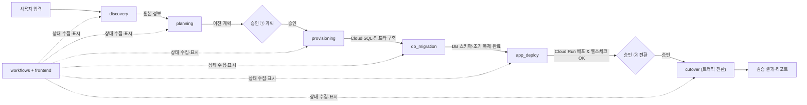

# 모듈 연결 계약 (workflows 관점) — 제안 초안

> **상태: 제안 (합의 전).** 아래 형식은 확정된 API가 아닙니다. 각 모듈 담당이 동의한 칸만 확정으로 바꿉니다.
> 실제 동작이 구현되기 전에는 이 규격으로 가짜 성공 응답을 만들지 않습니다.

## 1. 범위

- 1차 MVP: **AWS ECS Fargate + RDS PostgreSQL 16 → GCP (Cloud Run + Cloud SQL)** 한 가지 경로만.
- 온프레미스·EC2·전환 후 자동 원복은 1차 범위 밖입니다.
- `workflows`는 **연결만** 합니다. 각 모듈의 기술 구현을 다시 만들지 않고, 아래 계약으로 호출·조회·제어합니다.

## 2. 전체 흐름



`사용자 입력 → discovery → planning → [승인 ① 계획] → provisioning → db_migration → app_deploy → [승인 ② 전환] → cutover → 검증 결과`

### 전환 시퀀스 (Zero Downtime Cutover)
1. **Hold**: 프록시/게이트웨이에서 인바운드 쓰기 요청 큐잉·일시 홀드
2. **Sync Marker**: 원본 DB 최종 트랜잭션 마커 확인 및 CDC 복제 지연(Lag) 0초 수렴
3. **Switch**: 목적지 Cloud Run으로 라우팅 전환 (가중치 100%)
4. **Release**: 홀드된 요청 목적지로 방출 및 정상 응답 확인 (요청 실패 0건 보장)

## 3. 공통 규격 (제안)

모든 단계가 같은 틀을 쓰면 `workflows`와 대시보드는 모듈별 분기 없이 동작합니다.

| 동작 | 의미 | 주요 필드 |
| --- | --- | --- |
| `start` | 단계 실행 시작 | 입력 → `run_id`, `stage`, `started_at` |
| `status` | 진행 상태 조회 | `state`, `progress`(0~100), `metrics`, `message`, `updated_at` |
| `result` | 결과·산출물 | `outputs`(다음 단계 입력), `evidence`(로그·검증 근거 위치) |
| `pause` / `resume` / `abort` | 중단·재개·취소 | `state`, `reason` |

`state` 값: `pending` · `running` · `waiting_approval` · `paused` · `succeeded` · `failed` · `aborted`

- 종료 상태는 `succeeded` · `failed` · `aborted` 세 가지입니다. `abort`로 멈춘 실행은 `aborted`로 남기며, 성공이나 실패로 표시하지 않습니다.

```json
{
  "run_id": "mig-20261105-001",
  "stage": "db_migration",
  "state": "running",
  "progress": 62,
  "metrics": { "replication_lag_ms": 120, "rows_checked": 1000, "mismatch": 0 },
  "message": "CDC 동기화 중",
  "updated_at": "2026-11-05T21:10:00+09:00"
}
```

호출 방식(같은 프로세스 함수 호출 / HTTP / 작업 큐)과 상태 저장 위치는 **합의 필요**입니다.

## 4. 모듈별 계약

| 단계 | 호출 (무엇을 주면 실행되나) | 상태·결과 (다음에 넘길 것) | 제어 (승인·중단·재개) | 증거 (화면 표시 근거) |
| --- | --- | --- | --- | --- |
| **discovery** | GitHub 저장소 URL, AWS 조회 역할 참조, DB 접근 참조 | 인증서 등록 필요 여부, 컨테이너 Image URI·Tag, DB 엔진·버전·논리 디코딩·슬롯 상태 | 재실행 가능 여부 `합의 필요` | 수집 항목별 성공·실패 목록 |
| **planning** | discovery 결과 + 사용자가 고른 목적지 | 생성할 자원·순서·확인 항목이 담긴 이전 계획, 위험 설명 | **실행 전 사용자 승인 필수** (승인 화면) | 계획 본문, 코드 필수 조건과 AI 해석의 구분 |
| **provisioning** | 승인된 계획, IaC 입력값 | 목적지 실행 환경 주소, DB 접속 정보 **참조**, 네트워크·권한 결과 | 장시간 작업 상태 보고 방식 `합의 필요`, 실패 시 재시도 범위 `합의 필요` | Terraform 실행 결과·생성 자원 목록 |
| **db_migration** | 원본 DB 참조, 목적지 DB·연결 경로, DDL, CRUD API 규격 | 단계(점검→복제 구성→초기 복사→동기화→전환 준비→전환→안정화→종료), 쓰기 전환 준비 여부 | 전환 전까지 중단 가능, 목적지 신규 쓰기 후 자동 원복 없음 | 복제 지연, 행 수·데이터 대조 결과, 동기화 완료 마커 |
| **app_deploy** | 목적지 실행 환경(Cloud Run), 컨테이너 이미지 주소, 환경변수·시크릿 참조 | Cloud Run 서비스 URL, 배포 리비전, `/health/ready` 검증 완료 | **전환 승인 ② 전 배포 및 헬스체크 필수**, 실패 시 롤백 | `/health/ready` 200 OK 응답 및 레이턴시 |
| **cutover (트래픽 전환)** | 목적지 주소, 가중치/라우팅 계획, 프록시 설정 | 현재 가중치, 요청 홀드/방출 시점, 무중단 전환 결과 | **전환 직전 사용자 승인 ② 필수**, 전환 후 신규 쓰기 방출 | 가중치 변화, 전환 시간 T1−T0 (목표 ≤ 1초), 요청 실패 수 (목표 0건) |
| **workflows** | 이전 요청(대상·목적지·옵션), 사람의 승인·중단·재개 | 전체 실행의 단계별 상태와 결과 | 위 승인 지점에서 대기, 실패 단계에서 정지 | 모든 단계 상태를 한 화면에 모음 |

## 5. 대시보드 지표

| 지표 | 출처 | 비고 |
| --- | --- | --- |
| 전체·단계별 진행률 | 각 단계 `status.progress` | |
| 트래픽 가중치 (원본 / 목적지) | 트래픽 전환 | 담당 미정 |
| 복제 지연 | db_migration `metrics` | |
| 행 수·데이터 일치 검증 | db_migration `result.evidence` | MVP 완료 기준: 전환 시점 원본·목적지 행 수와 데이터 일치 자동 검증 |
| 전환 시간 T1−T0 | db_migration | 목표 ≤ 1초 |
| 요청 실패 수 | 트래픽 전환 / 부하 도구 | MVP 완료 기준: 프록시로 GCP 전환 시 사용자 요청 실패 0건 |

**표시 원칙**
- 모듈이 값을 주지 않으면 **"미제공"** 으로 표시합니다. 0이나 성공으로 채우지 않습니다.
- 구현되지 않은 모듈·단계는 **성공으로 처리하지 않습니다.** `미구현` 또는 `pending`으로 둡니다.

## 6. 22:00 회의에서 정할 것

1. **트래픽 전환 담당자** — MVP 완료 기준 "전환 시 사용자 요청 실패 0건"의 핵심입니다.
2. **승인 지점** — 제안: ① 계획 승인(provisioning 전) ② 전환 승인(db_migration 쓰기 전환 전).
3. **자동 실행과 수동 작업의 경계** — 1차 MVP에서 `workflows`가 자동으로 넘길 단계와 사람이 직접 넘길 단계.
4. 위 3절 공통 규격 채택 여부와 호출 방식(함수 / HTTP / 작업 큐).
5. 각 모듈 `status`·`result`의 실제 필드 — 담당자가 4절 표의 자기 행을 확정.
