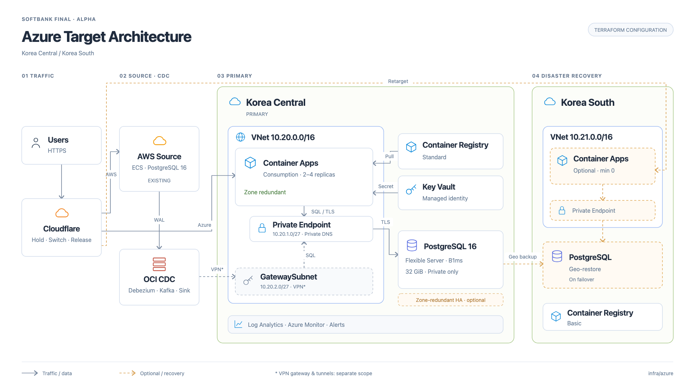

# Azure Target Architecture

Korea Central을 주 리전으로 사용하고, Korea South에 지역 장애 복구용 자원을 두는 Azure 목적지 구성입니다. 그림은 이 폴더의 Terraform 구성과 외부 연결 경계를 나타냅니다.

[벡터 원본](architecture/azure-target.svg)

## 주 리전 · Korea Central

| 영역 | 구성 |
| --- | --- |
| 네트워크 | VNet `10.20.0.0/16`, 앱 서브넷, Private Endpoint 서브넷, GatewaySubnet |
| 앱 | Container Apps Consumption, 영역 중복 환경, 기본 복제본 2~4개 |
| DB | PostgreSQL Flexible Server 16, 기본 B1ms·32 GiB, 공개 접속 차단 |
| 사설 연결 | Private Endpoint·Private DNS, NSG에서 앱 및 지정 CDC 대역의 DB 접속 허용 |
| 이미지·비밀 | Container Registry Standard, Key Vault, 사용자 할당 관리 ID |
| 관측 | Log Analytics, DB·서비스 상태 경보, 선택적 예산 알림 |

앱은 Private Endpoint를 통해 DB에 연결합니다. OCI CDC에서 목적지 DB로 들어오는 외부 경로에는 VPN이 필요하며, 이 구성에는 GatewaySubnet만 포함됩니다. VPN Gateway와 터널은 별도 범위입니다.

DB는 기본적으로 단일 영역이며, 지원 등급에서 영역 중복 HA를 선택할 수 있습니다. DB에는 삭제 잠금과 지역 중복 백업이 설정됩니다. 앱 리소스 생성은 인프라 생성과 분리되어 있습니다.

## 보조 리전 · Korea South

| 영역 | 구성 |
| --- | --- |
| 네트워크 | 별도 VNet `10.21.0.0/16`, 앱·Private Endpoint 서브넷 |
| 앱·이미지 | 선택적 Container Apps 환경, 기본 최소 복제본 0개, Container Registry Basic |
| DB 복구 | 장애 복구 시 geo-restore DB와 전용 Private Endpoint 생성 |

보조 리전은 상시 DB 복제가 아닌 pilot-light 구성입니다. 앱 환경과 이미지·비밀 준비 여부에 따라 앱 복구 가능 범위가 달라지며, DB 복구만으로 트래픽이 자동 전환되지는 않습니다.

## 외부 연결

- Cloudflare Worker는 기존 트래픽 제어 계층입니다. AWS 원본과 Azure 목적지 사이의 경로 변경을 담당합니다.
- AWS 원본과 OCI CDC는 이 폴더 밖의 자원입니다.
- 프론트엔드 클라우드 선택과 백엔드 모듈 연동은 별도 변경입니다.
- 그림의 주황 점선은 선택·복구 경로이며, 회색 점선 VPN은 별도 구축 범위입니다.
